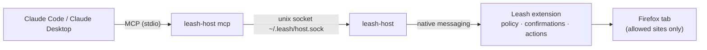

<div align="center">


# Leash

**Let Claude drive Firefox — on a short leash.**

Claude Code and Claude Desktop read pages, click, type and navigate in your Firefox
through an MCP bridge. A security policy written in Rust and compiled to WebAssembly
decides what is allowed — not the model.

[](https://github.com/Kirusshenkin/leash-firefox-extension/actions/workflows/check.yml)
[](https://github.com/Kirusshenkin/leash-firefox-extension/releases/latest)


[](LICENSE)

**English** · [Русский](README.ru.md)

</div>

---

## Why Leash

Browser agents read untrusted pages, and prompt injection has no complete fix. Leash
assumes the worst: **Claude is treated as compromised the moment it reads a page**.
Every action is checked by code against rules the page cannot change, so a successful
injection still can't do serious harm.

- 🔒 **Allowlist only.** Claude works only on sites you allowed — exact origin, no wildcards.
  Banking, payments, mail, password managers, cloud consoles, sign-in pages, messengers and
  marketplaces are blocked out of the box.
- ✋ **You confirm what matters.** Form submits, purchases, deletions, downloads and moving data
  between sites wait for your click in a separate Leash window that pages cannot fake.
- 🕵️ **Injection signs are surfaced.** Fake delimiters, `SYSTEM:` roles, chat markup and
  "ignore previous instructions" are flagged; after that, every non-read action needs approval.
- 🔑 **No API key.** Leash plugs into the Claude you already use — Claude Code or Claude Desktop.
- 📴 **The extension never goes online.** No default host permissions, `connect-src 'self'`;
  its only channel out is native messaging to the local bridge.

## How it works



Claude gets these tools:

| Tool | What it does |
|---|---|
| `read_page` | Structured snapshot of the active tab: numbered elements, roles, names, visible text |
| `click` · `type_text` · `select_option` | Act on an element from the snapshot |
| `scroll` · `navigate` · `go_back` | Move around allowed sites |
| `list_tabs` · `switch_tab` | Work across tabs (closed sites stay hidden) |

## Quick start

> Use a separate Firefox profile without important logged-in services
> (`about:profiles` → *Create a New Profile*).

**1. Bridge** (macOS arm64/x86_64, Linux x86_64) — prebuilt binary from GitHub Releases:

```sh
curl -fsSL https://raw.githubusercontent.com/Kirusshenkin/leash-firefox-extension/master/scripts/get.sh | sh
```

The script checks SHA-256 against the release's `SHA256SUMS`, installs `leash-host` into
`~/.local/bin` (override with `LEASH_BIN_DIR=…`, pin a release with `LEASH_VERSION=v…`) and
registers it with Firefox. Verify where the binary came from:

```sh
gh attestation verify ~/.local/bin/leash-host --repo Kirusshenkin/leash-firefox-extension
```

**2. Connect Claude:**

```sh
claude mcp add --scope user leash -- ~/.local/bin/leash-host mcp
```

For Claude Desktop, the installer prints a snippet for `claude_desktop_config.json`.

**3. Extension.** Until the add-on is on addons.mozilla.org: `make build`, then
`about:debugging#/runtime/this-firefox` → *Load Temporary Add-on…* → `extension/manifest.json`.

**4. Go.** Restart Firefox — the Leash sidebar (*View → Sidebar → Leash*) shows the bridge as
connected. Allow a site in Leash settings (Firefox asks for access when you save), then ask
Claude to do something there. It works in the active tab; steps show up in the sidebar.

Uninstall: `~/.local/bin/leash-host uninstall` and `claude mcp remove leash`.

<details>
<summary>Build the bridge from source instead</summary>

```sh
make install   # needs rustup; builds leash-host and registers it
```

A binary downloaded by hand through a browser is blocked by macOS Gatekeeper (it isn't
notarized); `get.sh` and source builds are not affected.

</details>

## Security model

<details open>
<summary><b>What is enforced</b></summary>

- **Site access** = an allowlist entry **and** a host permission granted by your click in
  Firefox. Exact match on https, host and port. The built-in deny list (payments, mail,
  password managers, cloud consoles, sign-in, government services, messengers and social
  networks, marketplaces with saved cards) cannot be lifted. Banks come pre-filled in your own
  deny list — add yours there. Access is checked before every action, and the content script
  re-checks the document origin right before acting.
- **Confirmation** happens in a separate Leash window; buttons unlock after 0.8 s. Asked for:
  form submits, buttons that look irreversible (buy, delete, send, publish, sell…), file
  downloads, and moving data between sites (typing or navigating with data in the URL after
  reading another site). A refusal is final for that action, and Claude is told not to work
  around it.
- **Blocked without asking:** sites outside the list, the built-in deny list, forms posting to
  closed addresses, `javascript:` links and links to closed sites, file inputs, typing into
  password, card and one-time-code fields (their values never reach the snapshot), CAPTCHAs,
  unknown or stale element numbers.
- **Swap-after-snapshot protection:** each element is pinned by facts (tag, role, name, link
  target, form action, whether it submits). They are recomputed before acting; any mismatch or
  an element covered by another one is a refusal.
- **Page data for Claude** is structured and wrapped in a delimiter with a fresh random nonce in
  every result. Angle brackets and quotes from the page are replaced; hidden elements
  (display/visibility/opacity, `aria-hidden`, `inert`, off-screen, tiny text, comments,
  templates) are left out.
- **Bridge:** Firefox launches `leash-host` only for the Leash extension (`allowed_extensions`).
  The socket is 0600 inside a 0700 directory, with owner and symlink checks. The bridge knows
  only Leash tools — unknown calls never reach Firefox. Calls from all Claude sessions run
  strictly one at a time; each session has its own working tab, read-site history and
  injection flags.
- **Content script** is injected on demand only into the top frame of an allowed tab, in an
  isolated world, with no access to extension APIs, network, messaging or timers (enforced by
  `scripts/check-static.sh`).
- **Limits:** the fourth identical call in a row is refused; a confirmation waits 5 minutes; a
  call Firefox doesn't answer in 330 s fails. *Stop* in the sidebar or <kbd>Alt+Shift+X</kbd>
  refuses open questions, and every call is refused until *Resume*.

</details>

<details>
<summary><b>Residual risks</b></summary>

- Claude sees data from allowed sites and keeps it in the conversation history. That is not a
  leak to third parties, but choose sites with this in mind.
- Leash can't see your conversation with Claude, so it doesn't know which text you asked to
  type: any input on a site after reading another site needs confirmation.
- The bridge socket is reachable by any program running as your user. The trust boundary is
  your account: a program already running as you could drive Firefox anyway.
- Hidden text that looks visible (same color as the background, text under another element)
  isn't filtered. Protection rests on the policy, not on the filter.
- A page can send its own data anywhere with its own JavaScript — that's the site, not Claude.
  Claude doesn't move data **between** sites without your consent.
- iframe content is neither read nor acted upon.

</details>

## Tested like an attacker

`make e2e` runs real Firefox (Marionette, headless) with the real bridge. A Go driver plays a
**compromised model** over MCP — exactly as Claude Code would connect — and answers in the
confirmation window. 54 scenarios cover the policy (S), data leaks and escapes from allowed sites
(X), Claude-in-Chrome-style rules (G), resilience (R: XSS, confirmations, disguised dangerous
words) and the bridge lifecycle (B). Separately, 40 pages with prompt injections were run
against Claude Opus through `claude -p` (one run): no request to a closed site, no form
submitted, no secret leaked. The attack pages are kept out of the repository.

CI runs `make check` (fmt, clippy, tests, WASM build, static checks, `cargo deny`,
`cargo audit`), the full e2e suite in headless Firefox, and a scan of the whole git history
for API keys on every push.

## Build

Requires rustup and `wasm-bindgen-cli` matching `Cargo.lock`:

```sh
cargo install wasm-bindgen-cli --version '=0.2.128' --locked
make hooks   # pre-commit guard against committing keys
make check   # fmt, clippy, tests, WASM build, static checks, cargo deny, cargo audit
make host    # the leash-host bridge (Rust, std only)
make e2e     # red-team tests in real Firefox with the real bridge (needs Go)
make zip     # AMO package in dist/
```

Rust dependencies come only from `vendor/` (`--offline --locked`). Without Homebrew, run `make`
with `RUSTUP_BIN=$HOME/.cargo/bin`. e2e flags: `-run <substring>`, `-headed`; Firefox comes
from `$FIREFOX`, `/Applications/Firefox.app` or `PATH`.

<details>
<summary>Project layout</summary>

- `crates/core` — shared by extension and bridge: budgeted JSON, tools and their strict parsing.
- `crates/host` — `leash-host`: MCP server (`mcp.rs`, `client.rs`), native messaging host
  (`native.rs`), framing (`frame.rs`), paths and permissions (`paths.rs`), install (`install.rs`).
- `crates/agent/src` — the extension (WASM): `policy.rs` (origins, lists, built-in deny),
  `guard.rs` (run / ask / refuse for every action), `probe.rs` (injection signs), `bridge.rs`
  (Claude sessions), `confirm.rs` (confirmation window), `page.rs` (snapshot → text for Claude),
  `protocol.rs`, `background.rs`, `sidebar.rs`, `options.rs`.
- `extension/` — manifest, HTML/CSS, JS glue and content script (≤ 200 lines together), generated `pkg/`.
- `docs/content-contract.md` — the content script contract.
- `e2e/` — red-team rig: real Firefox via Marionette, HTTPS proxy with test sites, real bridge,
  MCP driver acting as a compromised model.
- `scripts/` — static bans (`check-static.sh`), bridge install from source (`install.sh`) and
  from releases (`get.sh`).

</details>

## License

[Mozilla Public License 2.0](LICENSE). You can use Leash in any project, including closed ones;
changes to Leash files themselves stay open when you distribute them.

---

<div align="center"><sub>Leash is an independent project, not affiliated with Anthropic or Mozilla.</sub></div>
