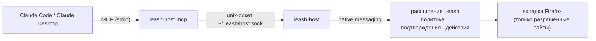

<div align="center">


# Leash

**Claude управляет Firefox — на коротком поводке.**

Claude Code и Claude Desktop читают страницы, нажимают, вводят текст и переходят
по сайтам в вашем Firefox через MCP-мост. Что можно, а что нельзя, решает
политика безопасности на Rust, собранная в WebAssembly, — а не модель.

[](https://github.com/Kirusshenkin/leash-firefox-extension/actions/workflows/check.yml)
[](https://github.com/Kirusshenkin/leash-firefox-extension/releases/latest)


[](LICENSE)

[English](README.md) · **Русский**

</div>

---

## Зачем Leash

Браузерный агент читает чужие страницы, а от prompt injection полной защиты нет.
Поэтому Leash исходит из худшего: **Claude считается скомпрометированным, как только
прочитал страницу**. Каждое действие проверяет код по правилам, которые страница
изменить не может, и даже успешная инъекция не причинит серьёзного вреда.

- 🔒 **Только разрешённые сайты.** Точный origin, без масок. Платежи, почта, менеджеры
  паролей, облачные консоли, входы в аккаунты, мессенджеры и маркетплейсы закрыты сразу.
- ✋ **Важное подтверждаете вы.** Отправка форм, покупки, удаление, скачивание и перенос
  данных между сайтами ждут вашего клика в отдельном окне Leash, которое страница
  подделать не может.
- 🕵️ **Признаки инъекции видны.** Поддельные разделители, роли `SYSTEM:`, разметка чатов,
  «забудь предыдущие указания» — после такой находки каждое действие, кроме чтения,
  требует подтверждения.
- 🔑 **Без ключа API.** Работает тот Claude, которым вы уже пользуетесь: Claude Code или
  Claude Desktop.
- 📴 **Расширение не ходит в сеть.** Нет host-разрешений по умолчанию, `connect-src 'self'`;
  единственный канал наружу — native messaging к локальному мосту.

## Как это устроено



Инструменты Claude:

| Инструмент | Что делает |
|---|---|
| `read_page` | Снимок активной вкладки: номера элементов, роли, имена, видимый текст |
| `click` · `type_text` · `select_option` | Действие с элементом из снимка |
| `scroll` · `navigate` · `go_back` | Перемещение по разрешённым сайтам |
| `list_tabs` · `switch_tab` | Работа с вкладками (закрытые сайты не видны) |

## Быстрый старт

> Лучше отдельный профиль Firefox без залогиненных важных сервисов
> (`about:profiles` → «Создать новый профиль»).

**1. Мост** (macOS arm64/x86_64, Linux x86_64) — готовая сборка из GitHub Releases:

```sh
curl -fsSL https://raw.githubusercontent.com/Kirusshenkin/leash-firefox-extension/master/scripts/get.sh | sh
```

Скрипт сверяет SHA-256 с `SHA256SUMS` релиза, кладёт `leash-host` в `~/.local/bin`
(другой каталог: `LEASH_BIN_DIR=…`, конкретный релиз: `LEASH_VERSION=v…`) и регистрирует
его в Firefox. Происхождение сборки проверяется так:

```sh
gh attestation verify ~/.local/bin/leash-host --repo Kirusshenkin/leash-firefox-extension
```

**Windows (preview):** в PowerShell

```powershell
irm https://raw.githubusercontent.com/Kirusshenkin/leash-firefox-extension/master/scripts/get.ps1 | iex
```

Ставит `leash-host.exe` в `%LOCALAPPDATA%\Leash\bin` и регистрирует его в
`HKCU\Software\Mozilla\NativeMessagingHosts\leash`. Мост для Windows проверен в CI (сборка,
канал, реестр), но ещё не прогнан целиком с настоящим Firefox на Windows. Дальше выполните
строку `claude mcp add`, которую напечатает установка.

**2. Подключить Claude:**

```sh
claude mcp add --scope user leash -- ~/.local/bin/leash-host mcp
```

Для Claude Desktop установка печатает фрагмент для `claude_desktop_config.json`.

**3. Расширение.** Пока дополнения нет на addons.mozilla.org: `make build`, затем
`about:debugging#/runtime/this-firefox` → «Загрузить временное дополнение…» →
`extension/manifest.json`.

**4. Готово.** Перезапустите Firefox — панель Leash («Вид → Боковые панели → Leash»)
покажет, что мост подключён. Разрешите сайт в настройках Leash (при сохранении Firefox
спросит доступ) и попросите Claude что-нибудь там сделать. Он работает в активной
вкладке, шаги видны в панели.

Удаление: `~/.local/bin/leash-host uninstall` и `claude mcp remove leash`.

<details>
<summary>Собрать мост из исходников</summary>

```sh
make install   # нужен rustup; собирает leash-host и регистрирует его
```

Бинарник, скачанный руками через браузер, macOS заблокирует: он не нотаризован.
`get.sh` и сборки из исходников это не касается.

</details>

## Модель защиты

<details open>
<summary><b>Что обеспечивает код</b></summary>

- **Доступ к сайту** = запись в списке разрешённых **и** host-разрешение, выданное
  Firefox по клику пользователя. Совпадение точное (https, имя, порт). Встроенный запрет
  (платежи, почта, менеджеры паролей, облачные консоли, входы в аккаунты, госуслуги,
  мессенджеры и соцсети, маркетплейсы с сохранёнными картами) не снимается. Банки стоят
  в пользовательском запрете по умолчанию — допишите туда свой. Доступ проверяется перед
  каждым действием, а content-скрипт ещё раз сверяет origin документа непосредственно
  перед действием.
- **Подтверждение** — в отдельном окне Leash; кнопки становятся активными через 0,8 с.
  Спрашивается: отправка формы, кнопки с признаками необратимого действия (купить,
  удалить, отправить, опубликовать, продать…), скачивание файлов, перенос данных между
  сайтами (ввод текста или переход с данными в адресе после чтения другого сайта). Отказ
  окончателен для этого действия, и Claude получает указание не обходить его.
- **Блокируется без вопросов:** сайты вне списка, встроенный запрет, формы, отправляемые
  на закрытый адрес, ссылки `javascript:` и на закрытые сайты, файлы, ввод в поля паролей,
  данных карт и одноразовых кодов (их значения не попадают и в снимок), CAPTCHA,
  несуществующие или устаревшие номера элементов.
- **Подмена после снимка:** элемент описывается фактами (тег, роль, имя, адрес ссылки,
  адрес формы, отправляет ли форму). Перед действием они вычисляются заново; любое
  расхождение или перекрытие другим элементом — отказ.
- **Данные страницы для Claude** идут структурой внутри разделителя со случайным nonce,
  новым в каждом результате. Угловые скобки и кавычки из страницы заменяются; скрытые
  элементы (display/visibility/opacity, `aria-hidden`, `inert`, вне экрана, мелкий шрифт,
  комментарии, шаблоны) в снимок не попадают.
- **Мост:** Firefox запускает `leash-host` только для расширения Leash
  (`allowed_extensions`). Сокет — права 0600 в каталоге 0700, проверяются владелец и
  отсутствие симлинков. На Windows канал — TCP только на 127.0.0.1 со случайным секретным
  токеном в `%LOCALAPPDATA%\Leash` (его читает только ваша учётная запись); без токена
  соединение закрывается. Мост знает только инструменты Leash: неизвестный вызов в Firefox
  не уходит. Вызовы всех сеансов Claude выполняются строго по одному; у каждого сеанса своя
  рабочая вкладка, свой список прочитанных сайтов и свои признаки инъекций.
- **Content-скрипт** внедряется по требованию только в главный фрейм вкладки разрешённого
  сайта, в изолированный мир, без доступа к API расширения, сети, сообщениям и таймерам
  (проверяет `scripts/check-static.sh`).
- **Ограничители:** отказ при четвёртом подряд одинаковом вызове; подтверждение ждёт
  5 минут; вызов, на который Firefox не ответил за 330 с, получает ошибку. «Стоп» в панели
  и <kbd>Alt+Shift+X</kbd> закрывают открытые вопросы отказом, и до «Продолжить» Claude
  получает отказ на каждый вызов.

</details>

<details>
<summary><b>Остаточные риски</b></summary>

- Claude видит данные разрешённых сайтов и хранит их в истории разговора — это не утечка
  наружу, но учитывайте при выборе сайтов.
- Leash не видит вашего разговора с Claude и не знает, какой текст вы сами попросили
  ввести: любой ввод на сайт после чтения другого сайта подтверждается.
- Сокет моста доступен любой программе, запущенной под вашим пользователем. Граница
  доверия — ваша учётная запись: такая программа и так может управлять вашим Firefox.
- Скрытый текст, неотличимый от видимого (цвет как у фона, текст под другим элементом),
  фильтр не ловит. Защита держится на политике, а не на фильтре.
- Страница сама может отправить свои данные куда угодно своим JavaScript — это поведение
  сайта, а не Claude. Claude не переносит данные **между** сайтами без вашего согласия.
- Содержимое iframe не читается, и в нём нельзя действовать.

</details>

## Проверено как атакующий

`make e2e` запускает настоящий Firefox (Marionette, без окна) с настоящим мостом. Драйвер
на Go играет **скомпрометированную модель** через MCP — так же, как подключается Claude
Code, — и отвечает в окне подтверждения. 54 сценария: политика (S), утечки и побег с
разрешённых сайтов (X), правила по примеру Claude in Chrome (G), устойчивость (R: XSS,
подтверждения, маскировка опасных слов) и жизненный цикл моста (B). Отдельно 40 страниц
с инъекциями прогнаны на Claude Opus через `claude -p` (один прогон): ни одного запроса
на закрытый сайт, ни одной отправленной формы, ни одной утечки секрета. Страницы атак
в репозитории не хранятся.

CI на каждый push: `make check` (fmt, clippy, тесты, сборка WASM, статпроверки,
`cargo deny`, `cargo audit`), весь e2e в headless Firefox и поиск ключей API во всей
истории git.

## Сборка

Нужны rustup и `wasm-bindgen-cli` той же версии, что в `Cargo.lock`:

```sh
cargo install wasm-bindgen-cli --version '=0.2.128' --locked
make hooks   # pre-commit против случайного коммита ключей
make check   # fmt, clippy, тесты, сборка WASM, статпроверки, cargo deny, cargo audit
make host    # мост leash-host (Rust, только std)
make e2e     # red-team тесты в настоящем Firefox с настоящим мостом (нужен Go)
make zip     # архив для AMO в dist/
```

Зависимости Rust берутся только из `vendor/` (`--offline --locked`). Без Homebrew
`make` запускается с `RUSTUP_BIN=$HOME/.cargo/bin`. Флаги e2e: `-run <подстрока>`,
`-headed`; Firefox берётся из `$FIREFOX`, `/Applications/Firefox.app` или `PATH`.

<details>
<summary>Структура проекта</summary>

- `crates/core` — общее для расширения и моста: JSON с бюджетом, инструменты и их строгий разбор.
- `crates/host` — `leash-host`: MCP-сервер (`mcp.rs`, `client.rs`), хост native messaging
  (`native.rs`), кадры (`frame.rs`), пути и права (`paths.rs`), установка (`install.rs`).
- `crates/agent/src` — расширение (WASM): `policy.rs` (origin, списки, встроенный запрет),
  `guard.rs` (выполнить / спросить / отказать), `probe.rs` (признаки инъекций), `bridge.rs`
  (сеансы Claude), `confirm.rs` (окно подтверждения), `page.rs` (снимок → текст для Claude),
  `protocol.rs`, `background.rs`, `sidebar.rs`, `options.rs`.
- `extension/` — манифест, HTML/CSS, JS-мост и content-скрипт (вместе ≤ 200 строк), сгенерированный `pkg/`.
- `docs/content-contract.md` — контракт content-скрипта.
- `e2e/` — red-team стенд: настоящий Firefox через Marionette, HTTPS-прокси с тестовыми
  сайтами, настоящий мост и MCP-драйвер в роли скомпрометированной модели.
- `scripts/` — статические запреты (`check-static.sh`), установка моста из исходников
  (`install.sh`) и из релизов (`get.sh`).

</details>

## Лицензия

[Mozilla Public License 2.0](LICENSE). Leash можно использовать в любом проекте, в том числе
закрытом; изменения в самих файлах Leash при распространении остаются открытыми.

---

<div align="center"><sub>Leash — независимый проект, не связанный с Anthropic и Mozilla.</sub></div>
